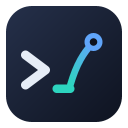

<p align="center">
  <a href="README.md">简体中文</a> | <b>English</b> | <a href="README.zh-TW.md">繁體中文</a> | <a href="README.ja.md">日本語</a>
</p>

<p align="center">
  
</p>

<h1 align="center">Tether</h1>

<p align="center">
  A lightweight multi-session terminal — sessions are held by a background process, so closing the window doesn't interrupt them; run Claude Code in a session and get notified when it finishes.
</p>

<p align="center">
  <a href="https://github.com/tongxin-77/tether/releases"></a>
  
  
  <a href="LICENSE"></a>
</p>

<p align="center">
  <a href="https://github.com/tongxin-77/tether/releases">Download</a> ·
  <a href="docs/usage.md">User guide</a> ·
  <a href="docs/development.md">Development</a> ·
  <a href="CHANGELOG.en.md">Changelog</a>
</p>

---

## ✨ Highlights

| Feature | Description |
|---|---|
| **Persistent sessions** | All terminal sessions are held by the windowless background process `tetherd.exe`; closing the window doesn't interrupt them. |
| **Claude Code integration** | Install hooks with one click; the sidebar shows Thinking / Awaiting approval / Background / Done live, with a system notification and sound when a task finishes. |
| **Input optimized for Claude Code** | Argument completion for the `claude` command; when the clipboard holds an image, Ctrl+V hands the image straight to Claude Code. |
| **SSH remote sessions** | Pure Rust implementation, one shared connection per host; supports keys, ssh-agent, passwords (saved to Windows Credential Manager) and `~/.ssh/config`. |
| **File tree** | Browse the current session's folder (over SFTP for remote sessions), upload / download, copy and paste across sessions, and preview Markdown in the app. |
| **Multiple windows and appearance** | Drag a session out into its own window; adjustable window background opacity; selectable default shell, with PowerShell 7 preferred. |
| **Windows Terminal-style copy and paste** | Copy on select, Ctrl+C copies only when there is a selection, right-click to paste, and you can even select just one column of cells in a table. |

## 📦 Installation

Download `tether_<version>_x64-setup.exe` from [Releases](https://github.com/tongxin-77/tether/releases) and run it (Windows 10/11, WebView2 required).

- By default it installs per user to `%LOCALAPPDATA%\tether`, and registers launch at login and system notifications during setup.
- Later versions check for updates automatically, and sessions keep running during updates.
- To use Claude Code in a session: just run `claude`, and click **Enable** under **Settings → Claude Code integration**.

## ⌨️ Common actions

| Action | Result |
|---|---|
| Drag-select / double-click / triple-click with the mouse | Copies on select (double-click selects whole paths and URLs) |
| <kbd>Ctrl</kbd>+<kbd>C</kbd> | Copies when there is a selection; otherwise sends an interrupt as usual |
| <kbd>Ctrl</kbd>+<kbd>V</kbd> / right-click | Pastes; when the clipboard holds an image, pastes the image to Claude Code |
| Drag-select inside a table cell | Selects only that column, rejoining wrapped lines within cells when copying |
| Type `claude --re` etc. | Shows argument suggestions; <kbd>↑</kbd> <kbd>↓</kbd> to choose, <kbd>Tab</kbd> to complete, <kbd>Esc</kbd> to close |
| Drag a session from the sidebar outside the window | Opens a separate window where you release it; the session returns to the main window when that window is closed |
| Right-click a session → New from this folder | Creates a new session in that session's starting folder (for remote sessions, the same folder on the same host) |
| **＋ New session** | Pick a local folder, or click a host to open an SSH session directly |
| <kbd>Ctrl</kbd>+<kbd>C</kbd> / <kbd>Ctrl</kbd>+<kbd>V</kbd> in the file tree | Copies files across sessions / hosts; you can also paste files copied in File Explorer |

See the **[User guide](docs/usage.md)** for full details.

## 🛠️ Building from source

Requires Node.js + pnpm, Rust stable and the MSVC build tools (see [Tauri prerequisites](https://tauri.app/start/prerequisites/)).

```sh
pnpm install
cargo build -p tetherd   # build the daemon first
pnpm tauri dev           # run in development
pnpm tauri build         # build the NSIS installer
```

Dev builds and the installed version use fully separate pipes, configuration and logs, so both can run at the same time. See **[Development and building](docs/development.md)** for the architecture, packaging details and log paths.

## 📚 Documentation

- [User guide](docs/usage.md) — settings, appearance, copy and paste, notifications, Claude Code integration, SSH, file tree and more
- [Development and building](docs/development.md) — architecture, running in development, dev / installed version isolation, packaging, launch at login
- [Requirements](docs/README.md) — frontend / background service / management server hub
- Third-party fonts: the UI fonts Nunito and JetBrains Mono are licensed under the SIL Open Font License 1.1 (packaged via @fontsource); see [docs/licenses](docs/licenses/) for the full license texts
- [Changelog](CHANGELOG.en.md)

## 📄 License

[Apache-2.0](LICENSE)
