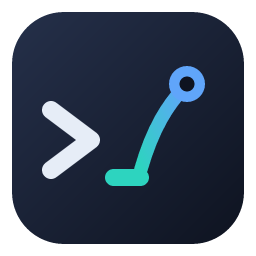

<p align="center">
  <a href="README.md">简体中文</a> | <a href="README.en.md">English</a> | <a href="README.zh-TW.md">繁體中文</a> | <b>日本語</b>
</p>

<p align="center">
  
</p>

<h1 align="center">Tether</h1>

<p align="center">
  軽量なマルチセッション ターミナル —— セッションはバックグラウンドプロセスが保持するため、ウィンドウを閉じても中断されません。セッション内で Claude Code を実行し、完了通知を受け取れます。
</p>

<p align="center">
  <a href="https://github.com/tongxin-77/tether/releases"></a>
  
  
  <a href="LICENSE"></a>
</p>

<p align="center">
  <a href="https://github.com/tongxin-77/tether/releases">ダウンロード</a> ·
  <a href="docs/usage.md">使い方</a> ·
  <a href="docs/development.md">開発とビルド</a> ·
  <a href="CHANGELOG.en.md">更新履歴</a>
</p>

---

## ✨ 特長

| 機能 | 説明 |
|---|---|
| **セッションの常駐** | すべてのターミナルセッションはウィンドウを持たないバックグラウンドプロセス `tetherd.exe` が保持し、ウィンドウを閉じても中断されません。 |
| **Claude Code 連携** | ワンクリックで hooks を書き込み、サイドバーに思考中 / 確認待ち / バックグラウンド / 完了をリアルタイム表示。完了時にはシステム通知と通知音でお知らせします。 |
| **Claude Code 向けに最適化された入力** | `claude` コマンドの引数を補完。クリップボードが画像のときは Ctrl+V で画像をそのまま Claude Code に渡します。 |
| **SSH リモートセッション** | 純 Rust 実装で、同じホストへの接続は 1 本を共有。鍵、ssh-agent、パスワード（Windows 資格情報マネージャーに保存）と `~/.ssh/config` に対応します。 |
| **ファイルツリー** | 現在のセッションのフォルダーを閲覧（リモートは SFTP 経由）。アップロード / ダウンロード、セッションをまたいだコピー・貼り付け、Markdown のアプリ内プレビューに対応します。 |
| **マルチウィンドウと外観** | セッションをドラッグして独立したウィンドウにできます。ウィンドウ背景の不透明度を調整でき、既定の shell を選択可能（PowerShell 7 を優先）。 |
| **Windows Terminal 風のコピー・貼り付け** | 選択するとコピー、選択範囲があるときだけ Ctrl+C でコピー、右クリックで貼り付け。表のセルを 1 列だけ選択することもできます。 |

## 📦 インストール

[Releases](https://github.com/tongxin-77/tether/releases) から `tether_<バージョン>_x64-setup.exe` をダウンロードしてインストールするだけです（Windows 10/11、WebView2 が必要）。

- 既定では現在のユーザー向けに `%LOCALAPPDATA%\tether` へインストールされ、インストール時にログイン時の自動起動とシステム通知が自動で登録されます。
- 以降のバージョンは自動で更新を確認し、更新中もセッションは中断されません。
- セッション内で Claude Code を使うには：そのまま `claude` を実行し、**設定 → Claude Code 連携** で **有効にする** をクリックします。

## ⌨️ よく使う操作

| 操作 | 結果 |
|---|---|
| マウスでドラッグ選択 / ダブルクリック / トリプルクリック | 選択するとコピー（ダブルクリックではパスや URL をまとめて選択） |
| <kbd>Ctrl</kbd>+<kbd>C</kbd> | 選択範囲があればコピー、なければ通常どおり割り込みを送信 |
| <kbd>Ctrl</kbd>+<kbd>V</kbd> / 右クリック | 貼り付け。クリップボードが画像のときは画像を Claude Code に貼り付け |
| 表のセル内でドラッグ選択 | その列だけを選択し、コピー時にセル内の折り返しを自動でつなぎ直す |
| `claude --re` などを入力 | 引数の候補を表示。<kbd>↑</kbd> <kbd>↓</kbd> で選択、<kbd>Tab</kbd> で補完、<kbd>Esc</kbd> で閉じる |
| サイドバーのセッションをウィンドウの外へドラッグ | ドロップした位置に独立したウィンドウを開く。閉じるとセッションはメインウィンドウに戻る |
| セッションを右クリック → このフォルダーで新規作成 | そのセッションの開始フォルダー（リモートは同じホストの同じフォルダー）で新しいセッションを作成 |
| **＋ 新しいセッション** | ローカルのフォルダーを選択するか、ホストをクリックして SSH セッションを直接作成 |
| ファイルツリーで <kbd>Ctrl</kbd>+<kbd>C</kbd> / <kbd>Ctrl</kbd>+<kbd>V</kbd> | セッション間 / ホスト間でファイルをコピー。エクスプローラーでコピーしたファイルも貼り付け可能 |

詳しくは **[使い方](docs/usage.md)** を参照してください。

## 🛠️ ソースからのビルド

Node.js + pnpm、Rust stable、MSVC ビルドツールが必要です（[Tauri の前提条件](https://tauri.app/start/prerequisites/) を参照）。

```sh
pnpm install
cargo build -p tetherd   # 先に daemon をビルド
pnpm tauri dev           # 開発モードで実行
pnpm tauri build         # NSIS インストーラーを作成
```

dev ビルドとインストール版はパイプ、設定、ログが完全に分離されているため、同時に実行できます。アーキテクチャ、パッケージングの詳細、ログのパスは **[開発とビルド](docs/development.md)** を参照してください。

## 📚 ドキュメント

- [使い方](docs/usage.md) —— 設定、外観、コピー・貼り付け、通知、Claude Code 連携、SSH、ファイルツリーなど
- [開発とビルド](docs/development.md) —— アーキテクチャ、開発時の実行、dev / インストール版の分離、パッケージング、ログイン時の自動起動
- [要件定義](docs/README.md) —— フロントエンド / バックグラウンドサービス / 管理サーバー hub
- サードパーティのフォント：UI フォントの Nunito と JetBrains Mono は SIL Open Font License 1.1 でライセンスされています（@fontsource 経由で同梱）。ライセンス全文は [docs/licenses](docs/licenses/) を参照してください
- [更新履歴](CHANGELOG.en.md)

## 📄 ライセンス

[Apache-2.0](LICENSE)
