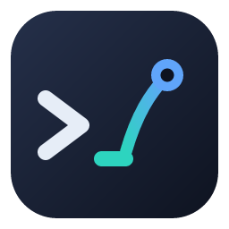

<p align="center">
  <a href="README.md">简体中文</a> | <a href="README.en.md">English</a> | <b>繁體中文</b> | <a href="README.ja.md">日本語</a>
</p>

<p align="center">
  
</p>

<h1 align="center">Tether</h1>

<p align="center">
  輕量多工作階段終端機 —— 工作階段由背景處理程序持有，關閉視窗不會中斷；可在工作階段中執行 Claude Code 並接收完成通知。
</p>

<p align="center">
  <a href="https://github.com/tongxin-77/tether/releases"></a>
  
  
  <a href="LICENSE"></a>
</p>

<p align="center">
  <a href="https://github.com/tongxin-77/tether/releases">下載</a> ·
  <a href="docs/usage.md">使用說明</a> ·
  <a href="docs/development.md">開發與建置</a> ·
  <a href="CHANGELOG.md">更新記錄</a>
</p>

---

## ✨ 特色

| 功能 | 說明 |
|---|---|
| **工作階段常駐** | 所有終端機工作階段由無視窗的背景處理程序 `tetherd.exe` 持有，關閉視窗不會中斷。 |
| **Claude Code 整合** | 一鍵寫入 hooks，側欄即時顯示思考中 / 等待確認 / 背景執行中 / 已完成，完成時跳出系統通知並播放提示音效。 |
| **為 Claude Code 最佳化的輸入** | `claude` 指令參數自動完成；剪貼簿內容是圖片時，Ctrl+V 直接把圖片交給 Claude Code。 |
| **SSH 遠端工作階段** | 以純 Rust 實作，同一主機共用一條連線；支援金鑰、ssh-agent、密碼（儲存至 Windows 認證管理員）與 `~/.ssh/config`。 |
| **檔案樹** | 瀏覽目前工作階段的目錄（遠端透過 SFTP），上傳 / 下載、跨工作階段複製貼上、在應用程式內預覽 Markdown。 |
| **多視窗與外觀** | 工作階段可拖曳出來成為獨立視窗；視窗背景透明度可調整；可選擇預設 shell，優先使用 PowerShell 7。 |
| **Windows Terminal 式複製貼上** | 選取即複製、有選取範圍時 Ctrl+C 才複製、按右鍵貼上，還能只選取表格中某一欄的儲存格。 |

## 📦 安裝

從 [Releases](https://github.com/tongxin-77/tether/releases) 下載 `tether_<版本>_x64-setup.exe` 安裝即可（Windows 10/11，需要 WebView2）。

- 預設以目前使用者身分安裝到 `%LOCALAPPDATA%\tether`，安裝時會自動註冊登入時自動啟動與系統通知。
- 之後的版本會自動檢查更新，更新時工作階段不會中斷。
- 想在工作階段中使用 Claude Code：直接執行 `claude`，並在 **設定 → Claude Code 整合** 按下 **啟用**。

## ⌨️ 常用操作

| 操作 | 效果 |
|---|---|
| 滑鼠拖曳選取 / 按兩下 / 按三下 | 選取即複製（按兩下時會整段選取路徑、URL） |
| <kbd>Ctrl</kbd>+<kbd>C</kbd> | 有選取範圍時複製，沒有時照常送出中斷 |
| <kbd>Ctrl</kbd>+<kbd>V</kbd> / 右鍵 | 貼上；剪貼簿內容為圖片時把圖片貼給 Claude Code |
| 在表格儲存格內拖曳選取 | 只選取該欄，複製時自動接回儲存格內的換行 |
| 輸入 `claude --re` 等 | 跳出參數候選清單，<kbd>↑</kbd> <kbd>↓</kbd> 選擇，<kbd>Tab</kbd> 補齊，<kbd>Esc</kbd> 關閉 |
| 將側欄的工作階段拖曳到視窗外 | 在放開處開啟獨立視窗；關閉後工作階段回到主視窗 |
| 在工作階段上按右鍵 → 從此目錄新增 | 在該工作階段的起始目錄（遠端為同一主機的相同目錄）新增工作階段 |
| **＋ 新增工作階段** | 選擇本機目錄，或點選主機直接建立 SSH 工作階段 |
| 檔案樹中 <kbd>Ctrl</kbd>+<kbd>C</kbd> / <kbd>Ctrl</kbd>+<kbd>V</kbd> | 跨工作階段 / 跨主機複製檔案，也可貼上在檔案總管中複製的檔案 |

完整說明請見 **[使用說明](docs/usage.md)**。

## 🛠️ 從原始碼建置

需要 Node.js + pnpm、Rust stable 與 MSVC 建置工具（請見 [Tauri 前置需求](https://tauri.app/start/prerequisites/)）。

```sh
pnpm install
cargo build -p tetherd   # 先編譯 daemon
pnpm tauri dev           # 開發執行
pnpm tauri build         # 封裝 NSIS 安裝檔
```

dev 建置與安裝版的管道、設定、記錄檔完全隔離，可同時執行。架構、封裝細節與記錄檔路徑請見 **[開發與建置](docs/development.md)**。

## 📚 文件

- [使用說明](docs/usage.md) —— 設定、外觀、複製貼上、通知、Claude Code 整合、SSH、檔案樹等
- [開發與建置](docs/development.md) —— 架構、開發執行、dev / 安裝版隔離、封裝、登入時自動啟動
- [需求文件](docs/README.md) —— 前端 / 背景服務 / 管理伺服器 hub
- 第三方字型：介面字型 Nunito 與 JetBrains Mono 以 SIL Open Font License 1.1 授權（經 @fontsource 封裝），授權全文請見 [docs/licenses](docs/licenses/)
- [更新記錄](CHANGELOG.md)

## 📄 授權條款

[Apache-2.0](LICENSE)
